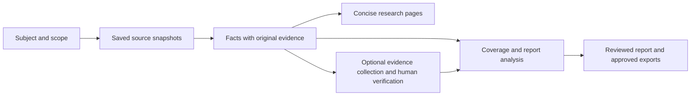

# Research model and report redesign: Phase 1

Status: proposed design, ready for review. Date: 2026-09-06.

This document describes future behavior. It does not change the running
application or supersede the existing report contract for saved reports.
Implementation starts only after the Phase 1 review. The worked examples in
[PHASE_1_EXAMPLES.md](PHASE_1_EXAMPLES.md) are part of this proposal.

## 1. Product outcome

A researcher supplies the subject and official documentation, then receives
compact research with a clear subject boundary, identifiable assets, and
traceable facts. The application handles document classification, extraction,
support checks, and report preparation. The researcher primarily reviews
conclusions and consequential unresolved issues.

Documentation is the first evidence source. Later, deterministic adapters
contribute dated market, governance, security, and onchain observations to the
same research framework. The design does not depend on those adapters existing.

The basic-user journey is:

1. **Add research:** enter a subject, choose Protocol, Chain, Token, or Coin,
   and supply documentation. Existing matching subjects are offered for reuse.
2. **Analyze:** collect documentation, determine scope, extract sourced facts,
   check their representation, and generate research pages. Show durable progress.
3. **Read:** open the subject overview, its research topics, related assets,
   or a short list of material unresolved issues. Sources open beside a fact.
4. **Generate report:** choose a full review or ask a focused question. The
   application prepares evidence, drafts, checks, and performs bounded repairs.
5. **Review and finalize:** review readable prose, material issues, and changes;
   explicitly approve the revision, then download Markdown, HTML, or PDF.

Verification remains an optional, separate activity. Collection and automatic
support checks cannot change a human verification decision.



## 2. Decisions proposed for approval

| Decision | Proposed behavior | Reason |
|---|---|---|
| Asset navigation | Tokens lists asset names and symbols; Coins lists native coin names and symbols | Assets remain discoverable independently of their originating projects |
| Identity | Stable IDs for subjects, assets, and deployments; names and tickers are labels | Prevent collisions and preserve identity through renames |
| Relationships | Explicit, sourced links between subjects, products, assets, and dependencies | A related product's facts must not become the parent subject's facts |
| Scope | Automatic classification with an optional concise scope editor | Avoid making the user classify every document |
| Fact lineage | Every material generated fact has exact saved source support and applicability | A report must not merely validate an earlier AI summary |
| Coverage | Topic questions with separate evidence, conflict, and freshness states | File count and workflow completion do not measure research completeness |
| Reports | Subject-specific assessment with a focused question option; recommendations optional | Useful research should not require a buy/sell stance |
| Workflow | One resumable generation action; human review and finalization remain explicit | Hide routine orchestration from the basic-user interface |
| Storage | Portable JSON records, Markdown pages, and immutable evidence snapshots | Extend the existing filesystem architecture without a database migration |
| Existing output | Additive migration and versioned report readers | Preserve user edits, old reports, provenance, and rollback |

## 3. Current implementation findings that constrain the design

These are observations of the local code, not requirements to preserve its shape.

- `registry_workflow.py` writes shared asset pages using the symbol alone and
  derives Tokens/Coins from the parent project's type. `dashboard.py` also
  builds ownership from symbols. `workspace.py` uses them when deleting data.
  Changing navigation labels without changing identity leaves those problems.
- Both `run_registry_workflow` and `registry_needs_token_discovery` suppress
  discovery when any existing token is present. Both paths need correction.
- `dependencies.py` fingerprints the selected corpus for every research page;
  a single source update can invalidate all pages. It can also adopt old pages
  without reconstructing their provenance. V2 must label legacy lineage unknown.
- `report_evidence.py` includes generated research as report evidence. V2 can
  use those pages to find relevant facts, but their material claims must resolve
  to original saved passages or explicitly identified analyst input.
- Current coverage tracks source categories. Keep that source inventory, but
  distinguish it from whether research questions have adequate answers.
- A branch keyed to the `aave-v3` slug performs additional network enrichment
  inside registry generation. Move existing behavior behind an explicit source
  adapter with snapshots; do not add similar branches for scope classification.
- The saved NEAR research mixes chain architecture with related systems.
  Its local corpus is available for later scoping evaluation. The historical
  Uniswap project and sources mentioned in HANDOFF.md are absent from this
  workspace as inspected on 2026-09-06. Do not claim to have resumed or validated
  that run; use a bounded new acceptance corpus if needed in a later phase.

## 4. Assets and the dashboard

The sidebar represents research subjects. A project is the working context
containing sources, scope, jobs, and notes for a subject; it is not the subject's
identity. Normally a subject has one active research project. Additional project
contexts can reference it without creating another asset.

Example navigation labels: **Aave (AAVE)** and **GHO (GHO)** under Tokens;
**NEAR (NEAR)** under Coins; protocol and chain projects remain in their own
groups. These labels illustrate navigation only, not researched identity data.

- Opening a token selects that asset and shows its own identity, deployments,
  documented mechanics, available observations, research, and reports.
- The page contains **Related protocols** and **Related chains** links. Opening
  an asset must not silently switch the title and controls to its parent protocol.
- A protocol overview can link to its issued or governance assets. Those links
  do not create duplicate sidebar entries or put the protocol name under Tokens.
- A discovered asset can initially have an identity page only. **Research this
  asset** creates a context using explicitly relevant existing sources; discovery
  does not silently start another crawl or AI workflow.
- Search matches name, symbol, and aliases. Identical name/symbol labels receive
  a short chain or issuer qualifier; address details remain available on the page.
- Coin classification is an asset property supported by its relationship to the
  chain. Tokens described in chain documentation still belong under Tokens.
- Protocol discovery remains limited to native/governance and materially
  protocol-issued assets. Collateral and external assets can be dependencies
  without receiving standalone research pages automatically. A user explicitly
  researching such an asset may create its own Token project.
- The asset has no inherited protocol-wide verification badge. Verified claims
  and observations retain their own subject and deployment scope.

### Identity and merge rules

Use application-generated opaque IDs, stored once and retained through updates.
Never derive identity from a display name, ticker, project slug, or one address.

A deployment records an asset, a namespaced chain reference, address or native
designation, network environment, and applicable version/time when known. Preserve
the source spelling; apply only chain-specific address normalization. Never
lowercase case-sensitive addresses indiscriminately. A native coin needs no
invented contract address.

An exact chain/address match is strong deployment-matching evidence. It is not
by itself proof that two cross-chain assets, bridged representations, or token
migrations share an economic identity. Cross-chain equivalence and replacements
require sourced relationships. Provider-specific IDs belong in external mappings.

When identity is unresolved, create separate provisional records and retain the
evidence. Automatically join records only when explicit identity evidence agrees
and there are no material conflicting attributes. An ambiguous merge affects only
that asset, not the rest of the research. Merges preserve old IDs as aliases,
history, references, and a reversal record. Same ticker alone never permits one.

### Incremental discovery

Discovery is keyed to the relevant source blocks, scope version, and discovery
contract/prompt version. A changed input schedules discovery even with existing
assets. An unchanged unsuccessful attempt does not consume calls on every resume.
Phase 2 uses the existing source-file and tokenomics fingerprints as a transitional
dependency key; Phase 3 introduces block indexing. Phase 2 must not depend on an
unimplemented V2 extractor to fix rediscovery.

Merge discoveries by stable identity and sourced fields. Preserve manual entries
and their provenance; conflicting discovered values become candidates for review.
Do not delete an asset because one crawl or model response omits it. Record removed
source support separately, retain history, and show the resulting limitation.

## 5. Automatic scope determination

### Two independent dimensions

Each document block can describe one or more subjects, and separately have a
content role. Page-level classification is a routing aid; extraction enforces
the distinction on individual facts.

| Dimension | Values | Effect |
|---|---|---|
| Relationship to the research subject | `core`, `related_product`, `dependency`, `out_of_scope`, `unresolved` | Determines attribution and where the fact belongs |
| Content role | `conceptual`, `economics`, `governance`, `security`, `reference`, `tutorial`, `administrative`, `mixed` | Determines research relevance and extraction depth |
| Applicability | Version, network, environment, effective period; unknown values allowed | Prevents obsolete, testnet, or product-specific statements becoming universal claims |

A tutorial may contain a critical withdrawal restriction. A reference page may
document privileged methods. Neither is excluded merely because of its role.
Likewise, a nearby product's security page is not automatically core evidence.

### Processing sequence

1. **Respect the collection boundary.** An exact page URL stays a page. A docs
   root allows discovery in that root. Where a dedicated docs host uses several
   top-level paths, inspect its navigation to determine the documented sections
   and show the inferred boundary. Domain fallback may discover candidates, but
   cannot silently authorize crawling unrelated products or other hosts.
   GitHub imports keep their repository/ref boundary. Register new external
   sources explicitly rather than allowing model instructions to fetch URLs.
2. **Save and index.** Preserve collected Markdown and immutable versions. Build
   titles, headings, navigational groups, and exact block locators without AI.
   Do not delete existing broader corpora; classification can operate on them.
3. **Build a subject map.** Use explicit titles, product names, declared versions,
   and navigation relationships. An inference-only provider handles ambiguous
   groups in bounded batches. Its decisions cite supplied blocks; unsupported
   relationships stay unresolved. A brand name alone does not establish ownership
   or operational dependence.
4. **Route extraction.** Analyze core blocks fully. Extract concise relationship
   and material exposure facts for related products and dependencies. Keep routine
   implementation detail searchable without processing every endpoint in depth.
5. **Check omissions.** Search headings and content across the retained corpus for
   security controls, asset custody, fees, withdrawals, upgrades, and version
   caveats. Reconsider likely material blocks routed to reference/out of scope.
   Include contradictory and limiting passages; relevance is not only similarity
   to the question. Record scope and extraction omissions separately.
6. **Publish scope.** Show a sentence describing the core subject, related systems,
   and any consequential ambiguity. The ordinary run continues automatically.

Unknown applicability is never filled from model prior knowledge. When an
ambiguity cannot be resolved internally, keep the relevant subsection qualified
and continue the rest. Ask one focused question only if choosing the main subject
or combining entities would otherwise make the entire result misleading.

Example structural outcome for the current NEAR corpus: distinguish base-chain
mechanics from Intents, bridge, and external-signing material. The exact relation
and exposure must come from saved documentation; this design does not predeclare
those systems part of consensus or assume that their risks propagate to it.

### Controls that reduce researcher work

The default scope card has **Researching**, **Related systems**, and **Needs
attention**. Advanced **Adjust scope** exposes versions, networks, and related
products. Manual overrides are versioned, survive reclassification, and invalidate
affected outputs. It is not a required checklist of hundreds of pages.

Show measurable job progress, saved work, and planned additional provider calls.
Group unchanged blocks and cache classifications. The job carries a finite call
budget and checkpoints; extending that budget is a visible user action, not an
unbounded internal retry. Phase 3 benchmarks set the default budget using actual
prompt sizes and corpus results rather than promising a fixed cost now.

## 6. Minimal shared data contracts

All records carry `schema_version`, stable identity, and UTC timestamps where
known. Unknown is `null`, not zero, an invented address, or an inferred date.
Immutable records use new revisions; mutable indexes point to committed revisions.
The following tables define the Phase 1 contract, not an implemented API.

| Record | Required information | Key invariant |
|---|---|---|
| Entity | `entity_id`, `kind` (protocol/chain/token/coin/product), name, aliases, identity status | Rename does not change identity; product is a related entity, not a new required sidebar group |
| Asset extension | `entity_id`, symbol, optional external mappings and deployment IDs | No ticker-based deduplication; blank names remain visibly unresolved |
| Deployment | `deployment_id`, asset ID, chain reference, native/address designation, environment, source references | Separate deployment identity from asset identity |
| Relationship | ID, from/to entity IDs, typed predicate, applicability, supporting references, assessment | `issued_by`, `governs`, `native_to`, `deployed_on`, `product_of`, `depends_on`, `representation_of`, `replaces`; related does not imply dependent |
| Project | Existing slug, `subject_id`, selected profile, scope revision, linked entity IDs, source registrations | Project owns workflow context, not a global asset |
| Scope revision | Subject, included versions/networks/products, block classifications, reasons/references, overrides, content/prompt fingerprints | No factual applicability inferred from folder placement alone |
| Source registration | Stable `source_id`, origin, source kind, declared authority and subject relationship, collection boundary | Officialness is provenance with a basis, not a truth flag |
| Snapshot | `snapshot_id`, source ID, content hash, media type, saved path, `captured_at`, known effective/published time, adapter/version and request context | Capturing today does not make the source's claims current today |
| Evidence reference | Snapshot ID, exact block/line or JSON-field locator, excerpt hash and required context | Must resolve against saved immutable content, not the live URL |
| Fact revision | Fact ID/revision, subject, applicability, kind, predicate and typed value or statement, evidence refs, support-check result, supersession/conflict refs | A documented claim and an observed value are separate records |
| Coverage item | Profile topic/question, relevance/materiality, fact refs, evidence state, conflict flag, freshness, gaps, next useful action | Documentation availability cannot satisfy a measurement requirement |
| Analysis assertion | Assertion ID, text, type, supporting fact revisions and original refs, reasoning, material qualifiers | Interpretations remain distinct from extraction facts |
| Verification decision | Claim/fact revision, applicable evidence revisions, proposal, explicit human decision and time | New evidence may require review; it cannot silently inherit approval |

Fact kinds are `documented_claim`, `observed_value`, and `analyst_statement`.
AI creates documented-claim proposals. Only deterministic collectors/adapters
create observed values. Analyst statements retain their author/input origin and
cannot masquerade as source documentation or independently observed values.

Observed quantities include decimal value, unit, denomination, subject and
deployment scope, metric definition, observation time or interval, and block
context where applicable. A success response with no value is not zero. Unknown
units, incompatible windows, or different metric definitions prohibit aggregation.
Adapters save the original response before normalization. A normalized record links
to exact input fields and records transformations; provider-specific metric names
do not silently become equivalent metrics. Derived values require deterministic
code, named inputs, compatible dimensions, and saved calculation provenance.

### Support checking and provenance

1. Deterministically verify every reference, hash, subject ID, literal quantity,
   unit, and required context. A copied number without its conditions is insufficient.
2. Independently compare each proposed material fact with its original excerpts.
   Request supported, needs qualification, contradicted, or unclear, with cited
   reasons. This checks representation, not real-world truth. Independence means
   a separate task/input boundary; it does not require another model vendor.
3. Correct or reject malformed/unsupported proposals with at most two targeted
   repair attempts per affected batch. Retain failed attempts for diagnostics.
4. Commit usable facts, preserving conflicting sources and unresolved candidates.
   Only usable facts may render as ordinary research assertions. A failed material
   candidate creates one contextual gap; it does not become a negative claim.

Research pages are views of those facts and source references. Generated summaries
do not count as new corroborating sources. Several pages repeating one original
claim share the same provenance root. Untraced legacy notes may aid retrieval but
cannot alone support a V2 factual assertion. An explicit analyst assertion is
possible, with visibly different provenance and report qualification.

## 7. Coverage and freshness

Use small, versioned profile definitions stored with the application. Select them
from the subject kind and documented product mechanics; permit optional overrides.
Profiles express research questions and acceptable evidence types, not templates
that demand a paragraph in every empty section.

| Profile | Core questions | Areas needing observations beyond docs |
|---|---|---|
| Chain | How execution/finality works; validator incentives; upgrade/control model; failure boundaries; native economics; dependencies | Validator concentration, activity, fees, outages, economic security |
| Protocol | What users do; asset/accounting flows; fee recipients; revenue versus incentives; liquidation/redemption; permissions; security; dependencies | Demand, utilization, revenue, liquidity, realized losses, deployment state |
| Token or coin | Rights/utility; enforceable value accrual; issuance and control; distribution; dilution; liquidity; relation to issuer/chain | Supply, holdings, unlock amounts, trading liquidity, valuation inputs |

Subprofiles such as lending or exchanges add a few relevant questions. They do
not introduce protocol-specific parsers. No universal protocol score, completeness
percentage, or model confidence percentage is required.

Each topic has independent dimensions:

- **Evidence:** `not_assessed`, `missing`, `partial`, `documented`, or `observed`.
  Documentation and observations can coexist through separate requirements in
  one topic. `observed` is not a universal higher truth grade.
- **Conflict:** none known or unresolved, with exact incompatible statements.
- **Freshness:** known as-of date and acceptable age, stale, or unknown. The
  policy depends on the metric and report request; age limits are saved.
- **Relevance:** applicable, unresolved, or not applicable with a sourced reason.

Source-registration categories continue to describe what was collected. Coverage
items describe what a question can be answered with. “Workflow complete” only
means scheduled work finished. A missing audit source is a coverage gap, not
proof that the subject has never been audited or is unsafe.

New snapshots create new facts or revisions; they do not overwrite historical
observations. An old and a new value are not a contradiction merely because they
differ. Compare subject, version, time, unit, definition, and environment first.
New sources also rerun affected topic retrieval, so a newly added contradiction
is considered even when the original selected evidence has not changed.

## 8. Report replacement

### Reader experience

The user chooses **Full review** or **Answer a question**. Use the subject's
profile and scope automatically. Optional audience, depth, and recommendation
intent are advanced controls. A full review delivers an assessment; it need not
recommend an investment or fabricate valuation inputs.

Default output is concise management prose, generally 800–1,500 words for a full
review and 250–600 for a question. These are editorial targets, not minimums or
hard truncation limits. Include only useful sections:

- An answer-first assessment explaining the main mechanism and implications.
- Analysis of the drivers relevant to the question and available evidence.
- Material risks, counterevidence, and uncertainties that change the conclusion.
- A qualified conclusion and what would materially change it.
- Readable citations to saved source passages/observations.

Separate Analyst Notes contain coverage, omitted evidence, unresolved research
work, and review diagnostics. A material limitation cannot be hidden there if
omitting it would make the management conclusion misleading. Missing minor data
should not dominate otherwise useful prose.

### Automatic preparation and review

1. Expand the request into profile questions and record the conclusion each
   evidence requirement could support. Classify whether the request asks for
   mechanics, historical measurement, current state, comparison, or valuation.
2. Retrieve eligible facts and original evidence by subject, applicability,
   time, and topic; use lexical search as an aid. Include supporting and contrary
   passages, caveats, and relevant dependencies. Do not treat balanced file
   sampling as coverage. Record bounded retrieval omissions and missing inputs.
3. Freeze the report's evidence bundle. For large structured records, produce
   deterministic field projections with original hashes, field locators, and all
   necessary subject/unit/time/block context. Preserve complete table rows and
   headers; never truncate a number or detach it from its meaning.
4. Draft structured sections containing prose blocks and linked assertion IDs.
   The model can write coherent narrative; the application renders Markdown and
   citations. Every material sentence, including the summary and conclusion,
   must map to assertions. No unreviewed synthesis appears only in prose.
5. Check assertion support against original evidence, all numeric/date claims,
   scope, citation coverage, unresolved conflict treatment, and conclusion strength.
   The quality pass also checks for unsupported comparative or valuation language.
6. Repair offending blocks in at most two report-wide rounds, rechecking affected
   assertions and every downstream summary/conclusion. Repairs use the same
   evidence snapshot. Further research creates a new evidence revision and is
   a separate visible action, not background browsing by the writer.
7. Present the reviewed draft or the specific remaining issue. All steps persist
   checkpoints. Retrying unchanged successful steps reuses their outputs.

Use errors versus advisory findings. Unsupported material assertions, missing
lineage, hidden decisive conflicts, and wrong-subject evidence block finalization.
A correctly disclosed missing input is not automatically a quality failure.

### Readiness, revisions, and approval

Readiness is relative to the requested answer: `ready`, `partial`, or
`insufficient`. A mechanics explanation can be ready from documentation. A token
valuation question cannot become ready merely because utility is documented.
A partial report clearly narrows its conclusion. With no substantive answer,
return a brief explanation and Analyst Notes; do not pad a report with gaps.

The visible lifecycle is **Generating**, **Needs attention** or **Ready to review**,
then **Final**. Internal checkpoints remain available to power users. These are
UI states, not new meanings for verification or job interruption.

Revisions can change a paragraph, section, or full draft. Preserve prior versions
and compare meaning as well as text. New evidence is allowed through an explicit
refresh/regenerate action; it creates a new evidence revision, reruns coverage
and checks, and clears approval for the new draft. Human edits use the same
reconciliation and review, never a silent overwrite.

Human finalization binds prose, Analyst Notes, assertions, evidence, coverage,
review, and scope to exact hashes. Optional recommendation approval applies only
when a recommendation is included. A later source update flags an old report as
historical; it does not invalidate the integrity or alter the approved publication.
New publication formats must match the frozen final revision. Export can include
data-backed charts suggested by the application, with ordinary user labels rather
than raw evidence IDs/JSON paths. Never type or infer chart values.

## 9. Storage, refresh, and interoperability

Proposed additions under the existing `output/` root:

```text
entities/<entity-id>/entity.json           # identity, asset fields, deployments
entities/relationships.json               # versioned sourced relationships
sources/<project-slug>/                    # retained collected Markdown
projects/<project-slug>/research-v2/
  scope.json                              # committed scope pointer and history
  sources.json                            # source registrations/snapshot index
  snapshots/<snapshot-id>/                 # immutable source + metadata
  facts/<fact-id>/<revision>.json          # immutable fact revisions
  coverage.json                           # committed profile coverage result
  runs/<run-id>/                          # durable plans, checks, dependencies
vault/<Protocols|Chains|Tokens|Coins>/<display-slug>--<entity-id>/
  Index.md                                # portable subject overview
  <topic>.md                              # concise research views
```

Use the full immutable ID in stored directory names and routes; human labels can
remain short. Once assigned, directory names need not change on a display rename.
Assets with several project contexts have one identity overview and explicitly
scoped context research, not one project's pages replacing another's. Project
views show sources from that context; cross-project reuse imports explicit
snapshot/fact references with ownership recorded.

V2 report packages live in versioned, distinct directories and contain the frozen
scope, coverage, facts, original evidence, assertions, prose, checks, approval,
revisions, and exports. Reuse security/integrity primitives where useful; no V1
layout or rendering API must constrain the new report content design.

JSON owns generated structured facts and their support contracts. Markdown stays
portable and editable. On a user edit, preserve the edited file, keep the last
generated revision, and present a proposed regeneration as a diff. An edited
statement joins machine-supported facts only after reconciliation; freeform
analyst notes remain readable without becoming evidence silently.

Refresh dependencies run from snapshot blocks and scope to facts, topics, and
draft assertions. New corpus inventory triggers candidate discovery and topic
coverage updates, not just rechecks of previously selected blocks. Unaffected
facts and pages are reused. Unchanged content hashes reuse extraction despite a
new capture timestamp. Classification/prompt/schema changes invalidate only the
stages that depend on them, with a displayed plan before a large reanalysis.

No model receives credentials or a tool-enabled agent context. Respect current
Hermes prompt limits through bounded batches. Preserve loopback/token checks,
path validation, HTML sanitization, atomic commits, and durable interruption
reporting. Shared entity changes need a workspace-level lock in addition to
project job locks. Interrupted multi-file operations recover from a committed
manifest/journal; readers never combine half-written revisions.

## 10. Migration and implementation boundaries

Migration runs first as a read-only inventory/preview. It lists identities,
ambiguous collisions, proposed paths, old-to-new links, and affected consumers.
Create backups and a migration journal before any write; validate the new records
before switching the active index. Repeating an interrupted migration is safe.

Existing project slugs and source paths can remain stable. Existing symbol-based
asset pages stay available as legacy files/aliases; resolve unambiguous links
through an alias map. Ambiguous old ticker links show choices rather than guessing.
Preserve user-edited content separately. An already overwritten asset page cannot
be reconstructed by renaming it: recover from project-owned registries/sources
where supported and explicitly record any unrecoverable content.

Project deletion removes its relationships and owned context. It never deletes a
shared asset, another project's evidence, or a frozen report's source support.
Reference accounting includes archived reports and manual notes as well as active
projects. Any unreferenced-data cleanup remains a separate explicit operation.
Reports embed their bounded original evidence, so approved publications are portable
even if the live project corpus changes. Backups are not cleanup targets.

Keep existing V1 report files, hashes, approvals, and legacy read/export handlers
intact. Do not relabel them as V2-reviewed. A user may create a new V2 report from
its old question, rebuilding source lineage as necessary. Existing extraction
ledgers are available for recovery/retrieval but are not automatically certified
as V2 facts. Old resumable states must not be resumed with a different contract.

Enable migrated identity and later V2 research per project only after validation.
Use compatibility readers and explicit version dispatch, not two independent
writers to the same page. Identity aliases can resolve old navigation links;
they must not rewrite paths or bytes inside frozen evidence and approvals.

Implementation must cover all identity consumers together in Phase 2:

| Current modules | Required adaptation |
|---|---|
| `workspace.py`, `registry_workflow.py` | Stable identity, discovery/upsert, owned versus shared data, migration and deletion |
| `dashboard.py`, `dashboard_assets/app.js`, `application.py` | Asset-centric routes, names, context selection and deduplicated navigation |
| `market_data.py` | Cache and match by asset/deployment identity; preserve existing snapshot provenance |
| `vault_indexes.py`, `obsidian_links.py` | Resolve stable identities and unambiguous legacy links; retain readable Markdown |
| `report_evidence.py`, `analyst_review.py`, verification planning | Resolve project-owned asset evidence without ticker-based cross-project lookup; keep V1 dispatch |

Later phases introduce the source/fact contracts before replacing report retrieval
and generation. The existing provider boundary, collector, and dashboard security
remain usable throughout; their outputs gain adapters rather than protocol-name
branches in research logic.

| Phase | Implementation boundary | Exit evidence | Recommended reasoning effort |
|---|---|---|---|
| 1 | This design and worked examples; no runtime changes | Identity, scope, fact, coverage, report, migration decisions reviewable | Extra high |
| 2 | Entity/asset identity, deployment matching, discovery refresh, navigation, non-destructive migration | Collision, rename, shared asset, standalone token/coin, manual preservation, deletion and resume cases pass | High |
| 3 | Source snapshots and block indexing; automatic subject scope; existing special enrichment isolated as an explicit source | Mixed-product corpus classified; critical reference facts retained; visible finite extraction plan; repeated run reuses scope | Extra high |
| 4 | Structured facts, original-source support checks, topic coverage and incremental pages | Wrong-subject, unsupported, conflicting, dated and updated facts handled correctly; manual edits preserved | Extra high |
| 5 | Report generation/revision/review UX and V2 contracts/export; V1 compatibility | Three profile reports and focused questions; original-source review, bounded repair and immutable approval/export | Extra high |
| 6 | Fresh dashboard/provider and collector acceptance across subjects | Durable terminal states, safe interruption/resume, useful concise research and reports, measured cost/workload | High; extra high for difficult failures |
| 7 | One selected additional data adapter using these contracts | Dated structured observations combine with docs without guessed identity or metric semantics | High |

These effort levels are planning recommendations, not model-setting changes or
cost estimates. No stage authorizes automatically starting the next phase.

## 11. Acceptance criteria and remaining uncertainties

Automated acceptance must exercise the adversarial cases in the companion
examples: same symbol, multiple deployments, added token, mixed page, stale
version, conflicting source, new contradictory input, missing valuation evidence,
source updates after approval, edited Markdown, interrupted migration and jobs.

During Phases 3–6, maintain a small annotated evaluation corpus with expected
subjects, material facts, and report conclusions. This is development QA, not
mandatory work for each researcher. Include held-out mixed documentation examples
so rules cannot simply memorize NEAR or one protocol's paths. Acceptance requires:

- No material fact attributed to the wrong core subject in that corpus.
- Every material output assertion resolves to original evidence or visibly
  identified analyst input; no factual assertion supported only by generated prose.
- Known material caveats/contradictions in the fixtures survive scoping and drafting.
- The same asset is not duplicated by project ownership; same-symbol assets stay
  distinct. Manual entries and old publications survive migration and refresh.
- Ordinary runs require no page-by-page scope approval. Material unresolved issues
  are specific and actionable; repeated copies collapse into one issue.
- Readers can understand a report without reading workflow diagnostics, and can
  inspect a material assertion's source in one action.
- Classification plus extraction call counts/input volume, elapsed time, retries,
  retained facts, and user interventions are recorded against the current baseline.
  Cost reduction alone cannot justify dropping critical facts. No fixed accuracy
  percentage is promised from a small acceptance corpus.

The classifier's recall, the quality of prose after assertion mapping, and the
extra provider cost of support checks remain empirical questions for later
phases. The process-lifecycle issue still needs a live acceptance test. Phase 1
does not claim to resolve those uncertainties through a design document.
